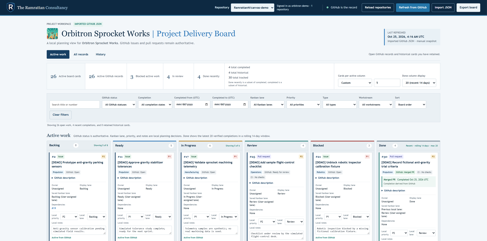

# Ramrattan Canvas

Ramrattan Canvas is a local, single-user Kanban board for GitHub issues and pull requests, from The Ramrattan Consultancy.  GitHub stays authoritative for every record's state, merge status, and completion date.  Canvas adds local planning on top: lanes, card order, priorities, workstreams, notes, and dependencies, saved separately for each repository in your browser.  It never writes to GitHub.



*Screenshots use the fictional Orbitron Sprocket Works demonstration board.  See [docs/demo/orbitron-sprocket-works.md](docs/demo/orbitron-sprocket-works.md).*

## Requirements

- Node.js 20 or later.  There are no package dependencies to install.
- The [GitHub CLI](https://cli.github.com/) (`gh`), signed in with `gh auth login`.
- A current desktop browser.  The Windows launcher and shortcut scripts are optional.

## Install and start

```powershell
gh repo clone RamrattanN/ramrattan-canvas-public
cd ramrattan-canvas-public
npm start
```

Open <http://127.0.0.1:4173/canvas/>.  Stop the server with Ctrl+C.  The server listens only on `127.0.0.1:4173`.

On Windows, `launch-canvas.cmd` starts the server in a minimized window when it is not already running and opens the board.  `powershell -NoProfile -ExecutionPolicy Bypass -File .\install-desktop-shortcut.ps1` creates a **Ramrattan Canvas** desktop shortcut to it.

Keep using the same address.  Saved boards belong to the browser origin, so `127.0.0.1:4173` and `localhost:4173` keep separate data.

## Authentication

Canvas has no sign-in of its own and stores no credentials.  Every GitHub read goes through the local server to the `gh` CLI, which keeps its token in the operating system's credential store.  The server removes GitHub token environment variables before starting `gh`, makes GET requests only, and never returns tokens or raw CLI output to the browser.  Canvas uses whichever account `gh` has active.  It never switches accounts.

## Repository discovery

The toolbar shows the signed-in `gh` account, the number of repositories it can read, and a **Repository** dropdown.  The list covers repositories the account owns, collaborates on, or reaches through an organization.  Another person's private repository appears only after it is shared with that account.

- **Reload repositories** re-reads the list without refreshing any board, for example after accepting an invitation or running `gh auth switch`.
- On first use, Canvas opens the first repository in the list.  After that it remembers your selection.
- Selecting a repository shows its saved board.  A repository with no saved board is refreshed from GitHub once.
- **Refresh from GitHub** updates only the selected repository.
- The server refreshes only names that pass strict `owner/name` validation and appear in the account's repository list.  Names reach `gh` as process arguments, never through a shell.

## How the board works

- **Active work** shows open issues and pull requests, recent completions in **Done**, and closed records you choose to **Retain in Active work**.  **History** shows closed records, and **All records** shows everything.
- Lanes are Backlog, Ready, In Progress, Review, Blocked, and Done.  Drag cards or use each card's lane selector.  A lane is a local planning choice and never changes GitHub.
- **Done is decided by GitHub.**  A merged pull request, or an issue closed as completed, appears in Done for 14 days after completion, latest 20 first.  Not-planned issues and closed, unmerged pull requests are never counted as completed.  A reopened record returns to active work.
- **Cards per active column**, in the summary panel, limits how many cards each working lane shows (25, 50, 75, 100, 200, All, or a custom 1 to 10,000).  Lane counts stay complete and capped lanes show **Showing N of M**.  Done is not limited.
- Search and filter by GitHub status, completion, completion date, lane, priority, type, and workstream.
- Issue #12 and pull request #12 are separate cards.
- The project heading shows the repository's display name and a small identity mark.  Trusted names and local icons are configured in `REPOSITORY_IDENTITIES` in `board-core.mjs`.  Other repositories show initials.

## Local data

Boards are saved in the browser's `localStorage`, under one key per repository: `ramrattan-kanban-canvas-v1:<owner>/<name>`.  A board saved by an earlier single-repository version stays under the original key, `ramrattan-kanban-canvas-v1`, for the repository recorded in it.  The saved data holds the latest GitHub records plus your local planning fields.  It never leaves your machine unless you export it.

- **Export board** downloads the board, including card order, as JSON.  **Import JSON** accepts a Canvas export, which restores its local planning, or GitHub issue and pull request JSON, which keeps your existing lanes.  It only accepts files for the selected repository.
- Clearing site data in the browser deletes saved boards.  Export first if you want a backup.
- `github-snapshot.json` is an empty starter file.  Canvas loads every board from GitHub through the CLI.

## Done column display

The Done column defaults to the newest 20 verified completions from the past 14 days.  Its independent dropdown offers 50, 100 or All to inspect older completions without affecting active-column limits.  Display settings are saved separately for each repository, and GitHub remains read-only and authoritative.  History retains closed records regardless of the Done setting.

## Demonstration board

The fictional Orbitron Sprocket Works board is built from a bundled synthetic snapshot of 30 `[DEMO]` records, with no GitHub access needed.  `npm run demo:fixture` builds the board, and `npm run demo:capture` verifies it in a disposable Chrome profile and regenerates the screenshots in `docs/demo/images/`, writing the overview image to `demo/out/` for review.  See [docs/demo/orbitron-sprocket-works.md](docs/demo/orbitron-sprocket-works.md).

## Troubleshooting

| Symptom | What to do |
|---|---|
| "GitHub CLI (gh) was not found" | Install the GitHub CLI, run `gh auth login`, then select **Reload repositories**. |
| "GitHub CLI is not signed in" | Run `gh auth login` (or `gh auth status` to check), then select **Reload repositories**. |
| A repository is missing from the list | Check the account shown in the toolbar.  Ask the owner to share the repository with that account, or run `gh auth switch`, then reload. |
| "That repository is not available" on refresh | The active account can no longer read it.  Its saved board stays visible. |
| The page does not load, or port 4173 is busy | Another Canvas server may already be running.  Use it, or stop it before running `npm start`. |
| My saved board is missing | Make sure the address is exactly `http://127.0.0.1:4173/canvas/` in the same browser profile. |
| Done looks empty | Done only shows completions from the last 14 days.  Older ones are in **History**. |
| CI shows "Unavailable" | CI is checked only for the 20 most recently updated open pull requests, and is informational. |

## Security and limitations

- Canvas is a local, single-user tool.  It is not designed to be exposed on a network or hosted.
- The server accepts only loopback `Host` headers and same-origin browser requests, sends a strict Content Security Policy, and serves a fixed list of files.  It does not authenticate local processes: software already running on your computer could request repository data through it while it runs.
- GitHub text is shown as escaped text, and token-like strings are redacted before display and export.  Exported files contain repository content and your notes, so treat them as private.
- Refresh reads up to 1,000 issues and 1,000 pull requests per repository, and up to 1,000 repositories.  There is no background sync, GitHub write-back, or multi-user support.

## Development

```powershell
npm test
```

Authorized collaborators work through branches and pull requests.  Do not push directly to `main`.

1. Clone the repository with an account that has access.
2. Create a focused branch from the latest `main`: `git switch -c <type>/<short-name> origin/main`.
3. Make the change and run `npm test`.  For UI changes, also run `npm start` and check the board.
4. Push the branch and open a pull request with `gh pr create --base main`.
5. Wait for the **Canvas tests** CI check to pass.  The repository owner reviews and merges.

Never commit exported boards, browser data, tokens, or other credentials.

## License

The source code is licensed under the [Apache License 2.0](LICENSE).  This arrangement is proposed and awaits final owner acceptance.  The [NOTICE](NOTICE) file reserves the names, trademarks, logos, and artwork, including The Ramrattan Consultancy name, the Ramrattan shield, and the Orbitron Sprocket Works artwork.  The license does not cover them.
